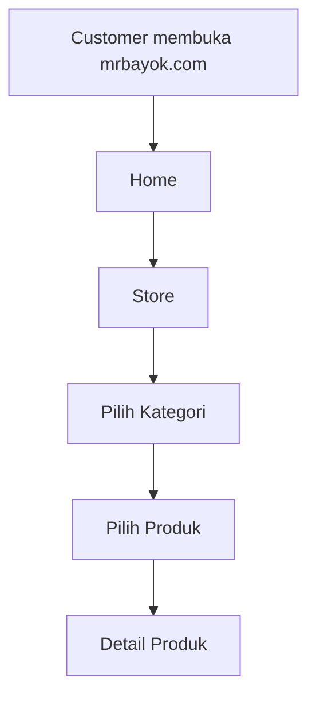
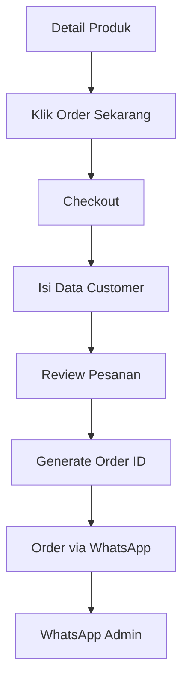
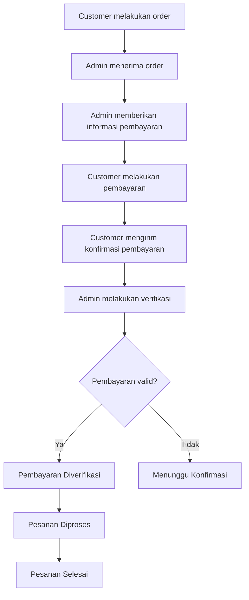
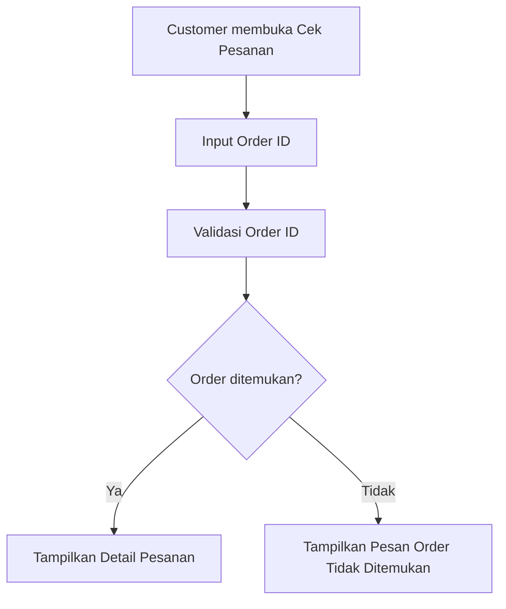
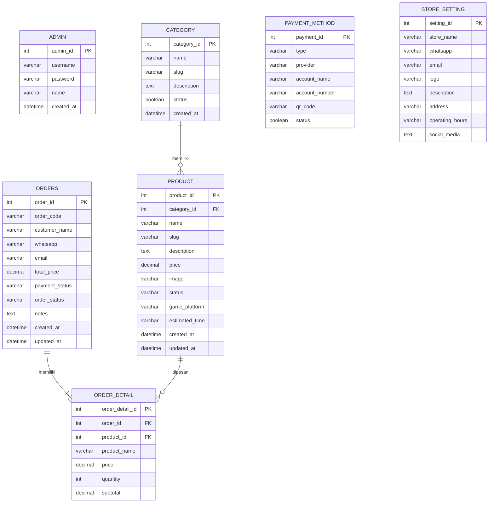

# PERANCANGAN MR BAYOK STORE

## 1. Gambaran Umum

### 1.1 Nama Sistem

**MR BAYOK STORE**

MR BAYOK STORE merupakan website toko digital yang menyediakan berbagai produk dan jasa digital, khususnya kebutuhan gaming seperti produk Roblox dan Steam.

Website terdiri dari dua bagian utama:

- Website Customer: `mrbayok.com`
- Admin Panel: `admin.mrbayok.com`

Website customer digunakan untuk melihat produk, mendapatkan informasi produk, melakukan pemesanan, serta mengecek status pesanan.

Admin panel digunakan untuk mengelola produk, kategori, pesanan, pembayaran, dan pengaturan toko.

---

## 2. Konsep Sistem

MR BAYOK STORE dirancang sebagai toko digital dengan konsep **Modern Gaming Store**.

Produk yang tersedia terdiri dari:

1. Robux
2. Item Roblox
3. Joki Roblox
4. Game Steam
5. Steam Wallet

Pada tahap awal, proses pemesanan menggunakan WhatsApp sebagai media komunikasi antara customer dan admin.

Customer memilih produk melalui website, mengisi data pemesanan, kemudian melanjutkan order melalui WhatsApp.

Pembayaran pada tahap awal dilakukan secara manual melalui transfer bank atau e-wallet.

---

# 3. Target Pengguna

## 3.1 Customer

Customer merupakan pengguna yang mengakses `mrbayok.com` untuk:

- Melihat produk.
- Mencari dan memilih kategori produk.
- Melihat detail produk.
- Melakukan pemesanan.
- Mengirim order melalui WhatsApp.
- Melakukan pembayaran.
- Mengecek status pesanan.

Customer tidak diwajibkan membuat akun atau melakukan login.

---

## 3.2 Admin

Admin merupakan pengelola MR BAYOK STORE.

Admin mengakses sistem melalui:

`admin.mrbayok.com`

Admin memiliki akses untuk:

- Mengelola produk.
- Mengelola kategori.
- Mengelola pesanan.
- Mengelola pembayaran.
- Mengelola pengaturan toko.

Admin panel dibuat terpisah dari website customer.

---

# 4. Struktur Website

## 4.1 Website Customer

Website customer menggunakan domain:

`mrbayok.com`

```text
MR BAYOK STORE
│
├── Home
├── Store
│   ├── Roblox
│   │   ├── Robux
│   │   ├── Item Roblox
│   │   └── Joki Roblox
│   └── Steam
│       ├── Game Steam
│       └── Steam Wallet
├── Detail Produk
├── Checkout
├── Order via WhatsApp
├── Cek Pesanan
├── Cara Order
└── Kontak
```

---

## 4.2 Admin Panel

Admin panel menggunakan subdomain:

`admin.mrbayok.com`

```text
ADMIN MR BAYOK STORE
│
├── Login
├── Dashboard
├── Produk
├── Kategori
├── Pesanan
├── Pembayaran
└── Pengaturan
```

Admin panel dibuat terpisah dari website customer.

---

# 5. Kategori Produk

## 5.1 Roblox

### 5.1.1 Robux

Produk berupa Robux dengan jumlah atau nominal tertentu.

Contoh:

- Robux 100
- Robux 400
- Robux 800
- dan sebagainya.

Informasi produk:

- Nama produk
- Jumlah Robux
- Harga
- Status ketersediaan
- Deskripsi

### 5.1.2 Item Roblox

Produk berupa virtual item dalam game Roblox.

Informasi produk:

- Nama item
- Game
- Gambar
- Deskripsi
- Harga
- Status ketersediaan

### 5.1.3 Joki Roblox

Produk berupa jasa untuk membantu customer mencapai target tertentu pada game Roblox.

Informasi produk:

- Nama jasa
- Game
- Target joki
- Deskripsi
- Harga
- Estimasi pengerjaan
- Syarat dan ketentuan
- Status ketersediaan

---

## 5.2 Steam

### 5.2.1 Game Steam

Produk berupa game yang tersedia untuk platform Steam.

Informasi produk:

- Nama game
- Gambar
- Deskripsi
- Harga
- Region
- Status ketersediaan

### 5.2.2 Steam Wallet

Produk berupa saldo Steam Wallet.

Informasi produk:

- Nominal
- Region
- Harga
- Status ketersediaan

---

# 6. Fitur Customer

## 6.1 Home

Halaman utama menampilkan:

- Logo MR BAYOK STORE
- Navigasi website
- Hero/banner
- Kategori produk
- Produk unggulan
- Produk terbaru
- Keunggulan toko
- Call to Action
- Informasi kontak
- Footer

---

## 6.2 Store

Halaman Store menampilkan seluruh produk yang tersedia.

Customer dapat:

- Melihat produk.
- Memilih kategori.
- Melihat harga.
- Melihat status produk.
- Membuka detail produk.

Filter kategori:

```text
Semua

Roblox
├── Robux
├── Item Roblox
└── Joki Roblox

Steam
├── Game Steam
└── Steam Wallet
```

---

## 6.3 Detail Produk

Halaman detail produk menampilkan informasi lengkap mengenai produk.

Informasi:

- Gambar produk
- Nama produk
- Kategori
- Game/platform
- Harga
- Status
- Deskripsi
- Informasi tambahan
- Syarat dan ketentuan
- Tombol "Order Sekarang"

---

## 6.4 Checkout

Customer tidak perlu membuat akun.

Customer mengisi data pemesanan seperti:

- Nama
- Nomor WhatsApp
- Email
- Username Roblox/Steam jika diperlukan
- Catatan
- Data tambahan sesuai jenis produk

Field checkout dapat berbeda berdasarkan jenis produk.

---

## 6.5 Order via WhatsApp

Setelah customer mengisi data checkout, sistem membuat ringkasan pesanan.

Contoh:

```text
MR BAYOK STORE

Order ID:
MBS-20261005-001

Produk:
Joki Blox Fruits Level 1-700

Harga:
Rp75.000

Nama:
Customer

WhatsApp:
08xxxxxxxxxx
```

Customer kemudian menekan tombol:

**ORDER VIA WHATSAPP**

Website membuat pesan WhatsApp secara otomatis dan mengarahkan customer ke WhatsApp admin.

---

## 6.6 Cek Pesanan

Customer dapat mengecek status pesanan menggunakan Order ID.

Contoh:

```text
Masukkan Order ID

[MBS-20261005-001]

[ CEK PESANAN ]
```

Informasi yang ditampilkan:

- Order ID
- Produk
- Total pembayaran
- Status pembayaran
- Status pesanan
- Waktu pemesanan
- Catatan jika tersedia

### Status Pesanan

```text
Menunggu Pembayaran
        ↓
Pembayaran Diverifikasi
        ↓
Diproses
        ↓
Selesai
```

---

## 6.7 Cara Order

Halaman berisi panduan sederhana:

```text
1. Pilih produk
        ↓
2. Buka detail produk
        ↓
3. Klik Order Sekarang
        ↓
4. Isi data pemesanan
        ↓
5. Klik Order via WhatsApp
        ↓
6. Lakukan pembayaran
        ↓
7. Admin memproses pesanan
        ↓
8. Pesanan selesai
```

---

## 6.8 Kontak

Halaman kontak menyediakan informasi:

- WhatsApp
- Email jika tersedia
- Social media jika tersedia
- Jam operasional
- Informasi lainnya

---

# 7. Sistem Pembayaran

## 7.1 Metode Pembayaran Tahap Awal

Pembayaran dilakukan secara manual melalui:

### Transfer Bank

Contoh:

- BCA
- BRI
- Mandiri
- Bank lainnya

### E-Wallet

Contoh:

- GoPay
- DANA
- OVO
- ShopeePay
- E-wallet lainnya

Informasi rekening dan e-wallet dapat dikelola melalui admin panel.

---

## 7.2 QR Code

Website dapat menampilkan QR Code untuk informasi pembayaran jika diperlukan.

Pada tahap awal, QR Code dapat berupa QR Code statis yang disediakan oleh toko.

Sistem belum menggunakan QRIS/payment gateway otomatis.

Integrasi payment gateway dapat ditambahkan pada pengembangan berikutnya.

---

# 8. Fitur Admin

## 8.1 Login

Admin mengakses:

`admin.mrbayok.com`

Admin harus melakukan login sebelum mengakses dashboard.

---

## 8.2 Dashboard

Dashboard menampilkan ringkasan:

- Total produk
- Produk aktif
- Total pesanan
- Pesanan baru
- Pesanan diproses
- Pesanan selesai
- Ringkasan pendapatan jika diperlukan

---

## 8.3 Kelola Produk

Admin dapat:

- Menambah produk.
- Melihat produk.
- Mengedit produk.
- Menghapus produk.
- Mengubah harga.
- Mengubah gambar.
- Mengubah deskripsi.
- Mengubah kategori.
- Mengubah status produk.

### Status Produk

```text
Tersedia
Tidak Tersedia
Nonaktif
```

---

## 8.4 Kelola Kategori

Admin dapat:

- Menambah kategori.
- Mengedit kategori.
- Menghapus kategori.
- Mengaktifkan/nonaktifkan kategori.

Kategori utama:

```text
Roblox
├── Robux
├── Item Roblox
└── Joki Roblox

Steam
├── Game Steam
└── Steam Wallet
```

---

## 8.5 Kelola Pesanan

Admin dapat melihat:

- Order ID
- Data customer
- Produk
- Jumlah
- Total harga
- Waktu order
- Status pembayaran
- Status pesanan
- Catatan

Admin dapat mengubah status pesanan.

---

## 8.6 Kelola Pembayaran

Admin dapat mengelola:

- Rekening bank
- Nomor e-wallet
- Nama pemilik rekening
- QR Code
- Status metode pembayaran

---

## 8.7 Pengaturan

Pengaturan dapat mencakup:

- Nama toko
- Logo
- Nomor WhatsApp
- Email
- Social media
- Jam operasional
- Informasi toko

---

# 9. User Flow

## 9.1 User Flow Melihat Produk



---

## 9.2 User Flow Pemesanan



---

## 9.3 User Flow Pembayaran



---

## 9.4 User Flow Cek Pesanan



---

# 10. Perancangan Database

Database awal direncanakan memiliki entitas:

```text
Admin
Category
Product
Order
OrderDetail
PaymentMethod
StoreSetting
```

---

## 10.1 Admin

Menyimpan data administrator.

Atribut:

- admin_id
- username
- password
- name
- created_at

---

## 10.2 Category

Menyimpan kategori produk.

Atribut:

- category_id
- name
- slug
- description
- status
- created_at

---

## 10.3 Product

Menyimpan data produk.

Atribut:

- product_id
- category_id
- name
- slug
- description
- price
- image
- status
- game_platform
- estimated_time
- created_at
- updated_at

Tidak semua atribut wajib digunakan untuk setiap jenis produk.

---

## 10.4 Order

Menyimpan data pesanan.

Atribut:

- order_id
- order_code
- customer_name
- whatsapp
- email
- total_price
- payment_status
- order_status
- notes
- created_at
- updated_at

---

## 10.5 OrderDetail

Menyimpan detail produk yang dipesan.

Atribut:

- order_detail_id
- order_id
- product_id
- product_name
- price
- quantity
- subtotal

---

## 10.6 PaymentMethod

Menyimpan metode pembayaran.

Atribut:

- payment_id
- type
- provider
- account_name
- account_number
- qr_code
- status

---

## 10.7 StoreSetting

Menyimpan informasi toko.

Atribut:

- setting_id
- store_name
- whatsapp
- email
- logo
- description
- address
- operating_hours
- social_media

---

# 11. ERD



---

# 12. Perancangan UI/UX

## 12.1 Konsep Visual

MR BAYOK STORE menggunakan konsep:

**Modern Gaming Store**

Karakter desain:

- Modern
- Clean
- Gaming
- Profesional
- Responsive
- Tidak terlalu ramai
- Fokus pada produk

---

## 12.2 Warna

### Primary Color — Blue

Digunakan untuk:

- Header
- Navigasi
- Background tertentu
- Brand identity
- Elemen utama

### Accent Color — Orange

Digunakan untuk:

- Tombol CTA
- Harga/promosi
- Highlight
- Badge
- Elemen penting

### Neutral Color

White / Light Gray / Dark Navy digunakan untuk:

- Background
- Card
- Text
- Section

Palet warna final akan ditentukan pada tahap desain di Google Stitch dan Figma.

---

## 12.3 Typography

Typography harus:

- Modern
- Mudah dibaca
- Cocok dengan tema gaming
- Memiliki hierarki yang jelas

Font final akan ditentukan pada tahap UI Design.

---

# 13. Responsive Design

Website harus dapat digunakan pada:

- Desktop
- Laptop
- Tablet
- Smartphone

Prioritas utama:

1. Smartphone
2. Tablet
3. Desktop

Komponen harus menyesuaikan ukuran layar.

---

# 14. Keamanan

Sistem harus memperhatikan keamanan terutama pada admin panel.

Ketentuan:

1. Admin panel dipisahkan menggunakan subdomain.
2. Admin wajib login.
3. Password admin tidak boleh disimpan dalam bentuk plaintext.
4. Session admin harus diamankan.
5. Akses halaman admin harus melalui autentikasi.
6. Input customer harus divalidasi.
7. Data sensitif tidak boleh ditampilkan secara sembarangan.
8. Sistem harus menggunakan HTTPS ketika sudah di-deploy.
9. Data database harus memiliki mekanisme backup.
10. Data login atau credential akun game tidak boleh disimpan secara sembarangan.

---

# 15. Arsitektur Domain

```text
                    MR BAYOK STORE
                          │
             ┌────────────┴────────────┐
             │                         │
             ▼                         ▼
       mrbayok.com             admin.mrbayok.com
             │                         │
             ▼                         ▼
     Customer Website            Admin Panel
             │                         │
             └────────────┬────────────┘
                          ▼
                       Database
```

Website customer dan admin menggunakan sumber data yang sama, tetapi memiliki fungsi dan hak akses yang berbeda.

---

# 16. Rencana Pengembangan

Pengembangan sistem dilakukan secara bertahap.

## Tahap 1 — Perancangan

- Menentukan kebutuhan sistem.
- Menentukan fitur.
- Menentukan struktur menu.
- Menentukan user flow.
- Menentukan database.
- Membuat ERD.

## Tahap 2 — Wireframe

Membuat wireframe menggunakan Google Stitch.

Halaman yang dirancang:

### Customer

- Home
- Store
- Detail Produk
- Checkout
- Cek Pesanan
- Cara Order
- Kontak

### Admin

- Admin Login
- Admin Dashboard
- Admin Produk
- Admin Kategori
- Admin Pesanan
- Admin Pembayaran
- Admin Pengaturan

## Tahap 3 — UI Design

Membuat desain final menggunakan Figma.

Fokus:

- Blue × Orange
- Modern gaming
- Responsive
- Product card
- Navigation
- CTA
- Dashboard admin
- Form
- Table
- Status badge

## Tahap 4 — Implementasi

Implementasi website berdasarkan desain final.

## Tahap 5 — Testing

Melakukan pengujian:

- Functional testing
- Responsive testing
- Form validation
- Admin authentication
- Order flow
- WhatsApp order
- Cek pesanan
- CRUD produk
- CRUD kategori

## Tahap 6 — Deployment

Deployment website:

```text
mrbayok.com
admin.mrbayok.com
```

---

# 17. Pengembangan Lanjutan

Fitur yang dapat dikembangkan setelah versi awal:

1. Integrasi QRIS otomatis.
2. Payment gateway.
3. Verifikasi pembayaran otomatis.
4. Notifikasi otomatis.
5. Sistem akun customer.
6. Riwayat pesanan customer.
7. Promo dan voucher.
8. Flash sale.
9. Wishlist.
10. Sistem rating dan review.
11. Laporan penjualan.
12. Statistik dashboard.

---

# 18. Catatan Keputusan Versi Awal

Beberapa keputusan yang digunakan pada versi awal:

### 18.1 Customer Tidak Perlu Login

Customer dapat melakukan pemesanan tanpa membuat akun.

Tujuannya agar proses pembelian lebih cepat dan sederhana.

### 18.2 Admin Dipisahkan ke Subdomain

Admin menggunakan:

`admin.mrbayok.com`

Website customer tetap menggunakan:

`mrbayok.com`

Hal ini membuat area administrasi terpisah dari area customer.

### 18.3 WhatsApp Sebagai Media Order

Alur transaksi awal:

```text
Pilih Produk
     ↓
Checkout
     ↓
Generate Order ID
     ↓
Ringkasan Pesanan
     ↓
Order via WhatsApp
     ↓
Admin Menerima Order
     ↓
Pembayaran Manual
     ↓
Verifikasi Pembayaran
     ↓
Pesanan Diproses
     ↓
Pesanan Selesai
```

Payment gateway otomatis dapat ditambahkan pada tahap pengembangan berikutnya.

---

# 19. Hal yang Masih Perlu Ditentukan

Bagian berikut belum dianggap final dan akan ditentukan sebelum implementasi:

1. Detail layout Home.
2. Tampilan halaman Store.
3. Desain kartu produk.
4. Detail halaman produk.
5. Field checkout untuk setiap kategori.
6. Apakah satu Order dapat berisi beberapa produk.
7. Detail status pembayaran.
8. Detail status pesanan.
9. Detail Dashboard Admin.
10. Kolom tabel Pesanan.
11. Struktur form Produk.
12. Struktur form Kategori.
13. Detail halaman Pembayaran.
14. Detail halaman Pengaturan.
15. Warna final.
16. Font final.
17. Logo dan identitas visual.
18. Breakpoint responsive.
19. Detail database final.
20. Detail implementasi WhatsApp.

Bagian ini akan menjadi dasar pembahasan lanjutan sebelum masuk ke tahap Google Stitch dan Figma.
